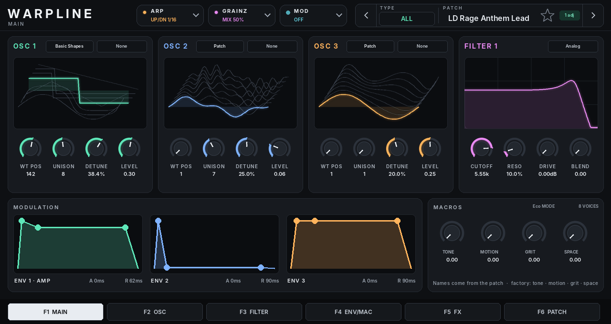
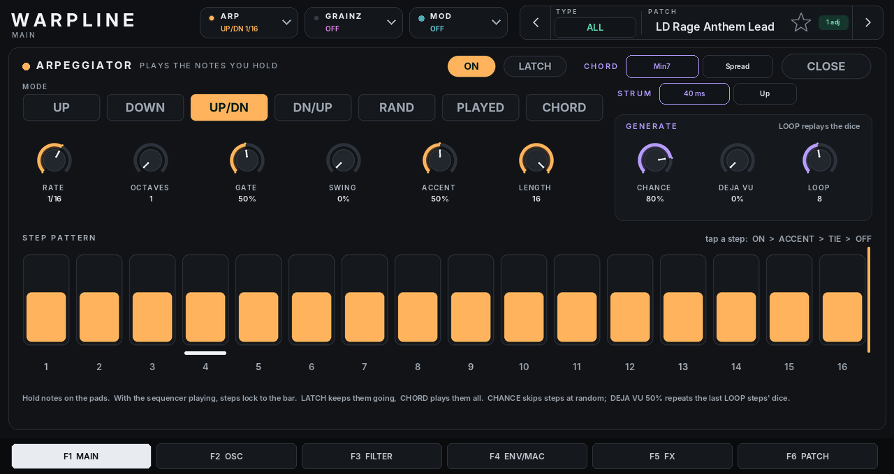
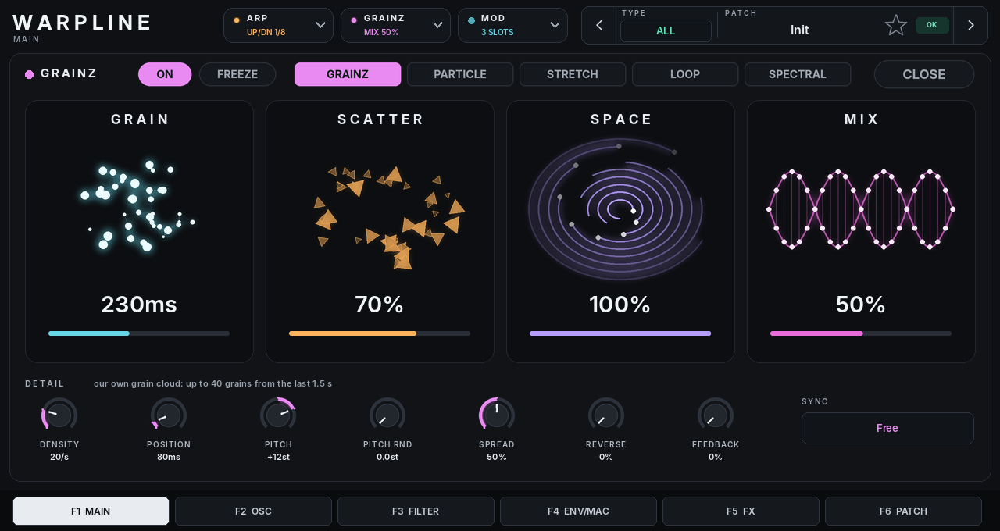
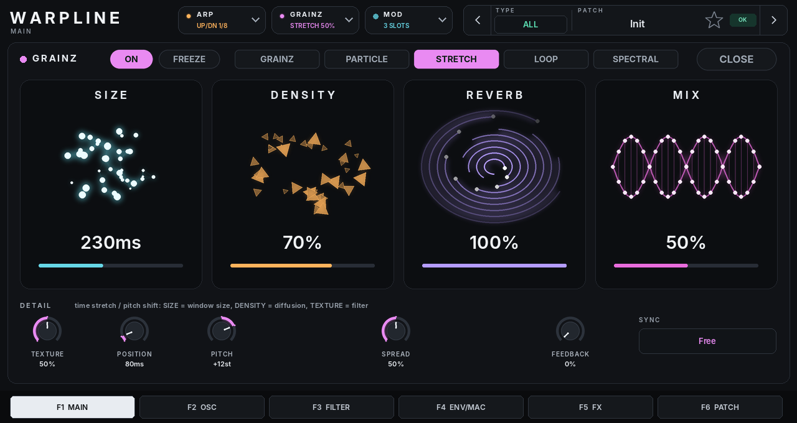
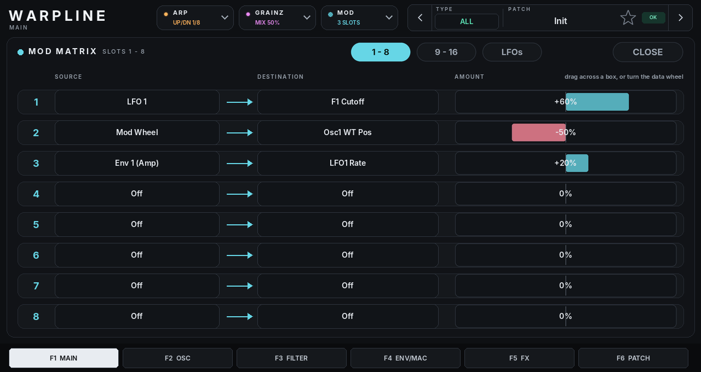
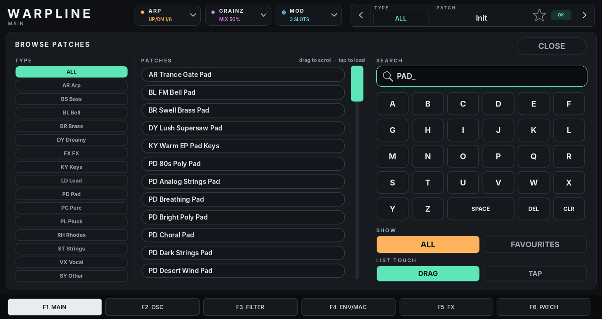
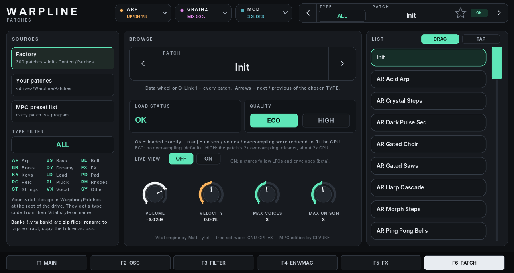

# Warpline for MPC (by CLVRKE)

The **Vital** spectral-warping wavetable synth engine, running as a plugin on MPC standalone, built with the MPC Plugin SDK.
It runs Vital's real engine, not a copy of it: the same oscillators, warps, filters, envelopes, LFOs, modulation matrix
and effects. It plays **.vital patches**. Vital's GUI is not included because the MPC has no plugin windows. Instead, 84 key controls are
spread over six custom-designed MPC pages that match the 16 Q-Links.

Designed for the **MPC Live III / MPC XL** (64-bit). It also builds for the 32-bit MPCs, but those CPUs are much slower, so expect only light patches and a few voices there.



**New in 1.1.0:** an arpeggiator with a 16-step pattern, the GRAINZ granular effect, a 16-slot mod matrix with four LFOs of its
own, preset search, favourites, outlined list rows, and lists you can scroll by dragging. Each of the three new sections has a chip in the header that shows
its state and opens its panel.

**Download:** the [Releases](https://github.com/CLVRK3/warpline-mpc/releases) page, or install it from the
[Open MPC catalog](https://open-mpc.github.io/) with the OpenMPC Plugin Manager.

## Install a release
Download from the [Releases](https://github.com/CLVRK3/warpline-mpc/releases) page:
- **MPC OS 3.10.1 and later (any MPC):** `warpline-X.Y.Z-mpc.zip`. Unzip it, copy the folder **`CLVRKE - VST - Warpline`** into
  **`VST2 Plugins`** at the root of a USB drive, SD card or the internal drive, and turn on **Preferences → Enhancements (Beta) →
  External Plugin Support**. `INSTALL.txt` inside has the steps.
- **Open MPC Plugin Manager / older firmware:** `Warpline-X.Y.Z-mpc-aarch64.zip` (MPC Live III / MPC XL) or
  `Warpline-X.Y.Z-mpc-armv7.zip` (older Gen1 MPCs), each with its own `INSTALL.md`; or install Warpline from the
  [Open MPC catalog](https://open-mpc.github.io/).

The 300 factory patches are included in the plugin folder. To add your own patches or banks, see
[Installing preset banks](#installing-preset-banks-vitalbank-and-vital) below.

## Build and install from source
1. Double-click **`BUILD.bat`** in this folder. It runs `python tools\build.py "plugins\Warpline"` and then packages the result.
   The engine is large, so the first build takes a few minutes per target.
   Output: `plugins\Warpline\build\CLVRKE - VST - Warpline\`, zip in `plugins\Warpline\dist\`.
2. Copy the folder **`CLVRKE - VST - Warpline`** into **`VST2 Plugins`** at the root of a USB drive or SD card.
3. On the MPC (MPC OS 3.10.1 or later), go to **Preferences → Enhancements (Beta)** and turn on **Enable Enhancements** and **External Plugin Support**.
   Restart the MPC so it rescans plugins, then load **Warpline** on a plugin track.

## Your own .vital patches
Put `.vital` files in a folder called **`Warpline/Patches`** at the root of the **same drive** as the `VST2 Plugins` folder
(subfolders are fine). Restart the plugin, and they appear after the factory patches, each with a two-letter type code (see below), both in the **Patch** control
and in the MPC's own preset list. Installed with the release installer or the Plugin Manager? See
[Installing preset banks](#installing-preset-banks-vitalbank-and-vital) for where the folder goes.

- Wavetables, LFO shapes, the modulation matrix, macros, effects and tuning stored in the patch are all loaded.
- The patch is saved inside your MPC project, so the project still sounds right if the file is removed later.
- **Status** (PATCH page) shows `OK`, or `n adj` when CPU limits changed something (for example unison 16 → 8). `Error` means the file could not be read.
- Vital's factory presets are not open source and are not included, but your own patches and any packs you own will load.
- Loading takes about 0.05–0.9 s. The plugin goes silent for that moment, just as Vital does.

## Screen (custom skin) and pages
The screen is a hand-built skin in the style of the original mockup: dark panels, colour-coded sections (mint, blue and amber
for oscillators 1-3, pink and violet for the filters), 3D wavetable displays, live filter curves and the MPC's own touch envelope
editors. Every page has four panels side by side, one per column of Q-Links. The patch bar (with ‹ › arrows and load status) is at
the top of every page.

| Page | Top row (Q-Link columns, left to right) | Bottom |
|---|---|---|
| **F1 MAIN** | Osc 1, Osc 2, Osc 3: WT pos, unison, detune, level · Filter 1: cutoff, reso, drive, blend | Amp / Env 2 / Env 3 envelopes · Macros 1-4 |
| **F2 OSC** | Osc 1-3: transpose, fine, warp, morph (+ warp mode) · Osc 1-3 and noise/sample on/off | Levels, unison, detune and WT pos of all three |
| **F3 FILTER** | Filter 1 model/style/keytrack/mix · Filter 2 cutoff/reso/drive/blend · Filter 2 model/style/keytrack/mix · F1/F2 on, glide, legato | Filter 1 tone · Env 2 |
| **F4 ENV/MAC** | Env 1 (amp), Env 2, Env 3: A, D, S, R with live envelope editors · Macros 1-4 | How the envelopes and macros work |
| **F5 FX** | Distortion · Delay · Reverb · Chorus and phaser | Signal chain |
| **F6 PATCH** | Patch browser (data wheel, Q-Link 1 or arrows), load status, Quality, Volume, Max Voices, Max Unison | Where your own patches go |

The wavetable displays show where WT POS is in the table (the lit frame moves). They are a stylised view, not the patch's real
wavetable, because a skin cannot draw a table that is loaded at run time. The filter curves follow cutoff and change shape
with the filter model.

Rebuild the skin after changing parameters: `python tools_build_skin.py` (needs Pillow and numpy and `build/params.json` from a build).
`python tools_preview_skin.py <state.json> <folder>` renders PNG previews of every page.

## CPU and memory: the "stripped down" part
- **Quality: Eco** (default) runs the engine without oversampling. **High** allows the patch's 2× oversampling, which sounds cleaner and uses about twice the CPU.
- **Max Voices** (default 8, at most 16) and **Max Unison** (default 8, Vital allows 16) cap a patch's polyphony and unison. Lower them if the MPC struggles.
- The engine is compiled with 16 voices at most (desktop Vital has 32), which brings memory down to about 85 MB per instance.
- Measured on a desktop core with 150 real-world .vital patches, 4 notes held: median 5.5 %, heaviest 15 % (factory patches: median 5 %, heaviest 14 %).
  The MPC's ARM cores are several times slower, so check heavy patches on the hardware.

## Sound types: the two-letter codes
Every patch name starts with a two-letter code for its type, so lists sort and read by type:

| Code | Type | Code | Type | Code | Type |
|---|---|---|---|---|---|
| **AR** | Arp | **FX** | FX | **PL** | Pluck |
| **BS** | Bass | **KY** | Keys | **RH** | Rhodes |
| **BL** | Bell | **LD** | Lead | **ST** | Strings |
| **BR** | Brass | **PD** | Pad | **VX** | Vocal |
| **DY** | Dreamy | **PC** | Perc | **SY** | Other |

- **Factory patches** have the code in their file name, and new ones get it automatically: `tools/make_factory.cpp` adds it from the patch's style.
- **Your own .vital files** get a code when the list is built. If the file name already starts with a code (`LD My Lead.vital`), that one is used.
  Otherwise Warpline looks for the label preset packs put in their names (`BA Hastings`, `Pack Name - PD Lifeline`, `FR2 - PLK - Fuhu`,
  `GS_BASS_Free_Chewer`, `Keys - Riot`, `SEQ`, `SFX`, `DRN` and so on) and shows the name without the pack prefix (`PD Lifeline`). Next it uses the
  patch's Vital style (Bass, Lead, Keys, Pad, Percussion, Sequence, SFX), then keywords in the file or folder name
  (pad, pluck, bass, rhodes, bell, choir and so on). If none of those match, it uses **SY**. Rename a file with a code to override the guess.
- Up to 6000 patches are listed in total (Init + factory + yours). Names show up to 24 characters.
- The list (Patch control and the MPC preset list) is sorted by type, then name: factory patches first, then yours.

**Filtering:** the **TYPE** box in the patch bar (on every page) and the TYPE FILTER box on the PATCH page choose a type. Picking one jumps to that
type's first patch, and from then on the ‹ › arrows step only through that type and wrap around. **ALL** steps through everything.
The data wheel and Q-Link 1 on the Patch control still go through the whole list.

## Velocity

Every patch responds to how hard you hit the pads or keys. **VELOCITY** on the PATCH page (Vital's "velocity track") sets how much
softer a soft note plays: 0% = every note the same level, 100% = level follows velocity fully, below 0% = soft notes louder.
It is saved with the patch and the project, and works on your own .vital files too (most of them come in at 0%).

Factory patches are set by type: Rhodes 75%, Perc 70%, Keys 65%, Plucks and Bells 60%, Brass 50%, Bass and Strings 40%,
Leads and Vocals 35%, Arps 30%, Pads and Dreamy 25%, FX 10%. Keys, plucks, bells, brass, strings, basses and leads also get a
little brighter the harder you play (velocity opens filter 1; a medium hit sounds as before). Played instruments (keys, plucks,
bells, perc, Rhodes) have the compressor off, because it would even the levels out again; organs keep theirs.

## Live View (beta)

**LIVE VIEW** on the PATCH page makes the wavetable and filter pictures follow LFOs, envelopes, velocity and macros while
notes play (about 12 updates a second), instead of only the knob positions. It is off by default. The live pictures run on
display-only parameters that cannot be automated, so recording automation never picks them up. If the pictures stutter or
the screen feels slow on your MPC, switch it off.

## Header chips: ARP, GRAINZ, MOD
The three chips at the top of every page show what each section is doing (for example `UP/DN 1/8`, `MIX 50%`, `3 SLOTS`).
Tap a chip to open its full-screen panel and tap **CLOSE** to go back. Only one panel (or the browser) is open at a time.

### Arpeggiator (ARP)


- **ON** and **LATCH** (keeps playing after you let go; a new chord replaces the old one).
- **Mode:** Up, Down, Up/Down, Down/Up, Random, As played, Chord (all held notes on every step).
- **Rate** 1/4 to 1/32, with dotted and triplet values. **Octaves** 1-4, **Gate**, **Swing**, **Accent** (how much louder an accented step is) and **Length** (1-16 steps).
- **Step pattern:** 16 steps. Tap a step to change it: On > Accent > Tie (holds the note into the next step) > Off. The bar after the last step shows the length, and a marker
  under the steps shows the one that is playing.
- With the MPC's sequencer playing, the steps lock to the song position. Otherwise they start on the first note you play.
- The arp plays Warpline's own voices. MPC doesn't pass plugin MIDI on, so it can't drive other tracks.

### GRAINZ (granular effect)


GRAINZ is a granular effect on Warpline's output. It keeps the last 1.5 seconds of sound and plays it back as up to 40 overlapping grains.
- **GRAIN:** grain length (10-500 ms). **SCATTER:** how randomly grains are placed in time. **SPACE:** diffusion (a smeared, roomy tail). **MIX:** dry/wet.
  Drag across a column, or select it and turn the data wheel. The pictures change with the value.
- **Detail:** density (grains per second), position (how far back grains start), pitch (±24 semitones), pitch random, stereo spread, reverse
  (chance that a grain plays backwards), feedback, and **SYNC** (grains on 1/4 to 1/16T instead of the density knob).
- **FREEZE** holds the buffer, so the grains keep playing what is already in it.



**Engines.** The buttons along the top choose how GRAINZ works:
- **GRAINZ:** Warpline's own grain cloud, as described above.
- **PARTICLE, STRETCH, LOOP and SPECTRAL:** texture modes, built on Emilie Gillet's open-source granular processor (MIT licence, see
  `third_party/mutable`). They work on about the last second of sound. In these modes the columns are titled
  **SIZE / DENSITY / REVERB / MIX**, and a **TEXTURE** knob takes the place of density in the detail row. A line under DETAIL says what
  each control does in the chosen mode:
  - **PARTICLE:** grains. DENSITY in the centre = few grains, to the left = regular, to the right = random. TEXTURE = grain shape, and
    diffusion at the top of its range.
  - **STRETCH:** time stretch and pitch shift. SIZE = window size, DENSITY = diffusion, TEXTURE = filter (low-pass to the left, high-pass
    to the right).
  - **LOOP:** a looping delay. POSITION = delay time, FREEZE turns it into a loop, SIZE = loop length, TEXTURE = filter.
  - **SPECTRAL:** spectral processing. SIZE = warp, DENSITY = how often the spectrum refreshes (and phase blur), TEXTURE = quantise.
  - **In every texture mode:** PITCH, SPREAD, FEEDBACK and FREEZE work as their names say. SYNC sends a trigger on each beat line
    (in PARTICLE, a trigger fires a grain). The processor runs at its own 32 kHz, so the wet sound is band-limited to about 14 kHz.
    The dry sound isn't affected.

### Mod matrix (MOD)


- **16 slots** on two pages (1-8, 9-16). Each slot has a source, a destination and an amount (-100 to +100 %).
- **Sources:** Env 1-3, the matrix's LFO 1-4, velocity, mod wheel, aftertouch, random (a new value per note), macros 1-4.
- **Destinations:** wavetable position, level, detune, warp, morph, pitch and pan of each oscillator, cutoff, reso, drive, blend and mix of both filters,
  distortion, chorus, phaser, delay and reverb amounts, the matrix LFO rates, and volume.
- **LFOs page:** shape (sine, triangle, saw up, saw down, square), sync (seconds, tempo, dotted, triplets, keytrack), tempo, mode (trigger, sync, envelope ...)
  and rate (used when sync is set to Seconds).
- The matrix comes on top of the patch's own modulation and stays the same when you change patches. Inside the engine, its LFOs are Vital's LFO 5-8.
  While a slot uses one of them, that LFO follows the matrix. When no slot uses it, it goes back to what the patch set.

## Patch browser and list





- **Browser:** tap **TYPE** or **PATCH** in the bar at the top of any page. A full-screen browser opens with types on the left
  (tap one to filter), patches in the middle and search on the right. Each patch sits in its own rounded outline, and the playing patch's
  row is filled. Tap **CLOSE** to go back to the page.
- **Scrolling:** drag the list up or down, or use the bar on its right. With **LIST TOUCH: DRAG**, a quick tap on a row loads that patch.
  If tapping picks the wrong row on your MPC, switch to **TAP**: dragging the list then stops, and each row works as a plain button.
- **Search:** type on the on-screen keyboard (A-Z, SPACE, DEL, CLR). The list shows the patches whose names contain the text,
  inside the chosen type. The arrows also step through those patches only.
- **Favourites:** tap the **star** next to the patch name in the header to add or remove the patch. In the browser,
  **SHOW: FAVOURITES** lists only those. Favourites are saved to `<drive>/Warpline/Favourites.txt` (one patch file name per
  line), so they survive updates and work in every project.
- **PATCH page list:** the same list, nine rows at a time, with its own scroll bar and DRAG/TAP switch.
- The MPC's own double-tap menus show plugin lists without any text, so Warpline does not use them. The arrows, the data wheel
  on the big PATCH box, Q-Link 1 and the MPC's preset list (every patch is a program) also change patches.

## Factory patches (300)
Init plus 300 patches in 14 types (at least 10 of each). They use about 135 different wavetables from more than 50 wavetable families, 7 of
Vital's 8 filter models, mono/legato and poly voicing, oscillator warps, spectral morphs, and tempo-synced LFOs, gates and random modulation.

- **Arp (16):** AR Acid Arp, AR Crystal Steps, AR Dark Pulse Seq, AR Gated Choir, AR Gated Saws, AR Harp Cascade, AR Morph Steps, AR Ping Pong Bells, AR Pulse Train, AR Random Blips, AR Retro Arcade, AR Saw Sequence, AR Seq Bubbles, AR Sidechain Stabs, AR Trance Gate Pad, AR Triplet Motion
- **Bass (27):** BS 808 Glide, BS Acid Line, BS Bit Bass, BS CZ Resonance Bass, BS Deep House Organ Bass, BS Detuned Square Bass, BS Diode Bite, BS Dubstep Yoi, BS FM Growl, BS Fat Unison Bass, BS Foldback Bass, BS Formant Growler, BS Formant Wobble, BS Garage Organ Bass, BS Liquid Sub, BS Moog Thump, BS Neuro Grind, BS Plaits Thump, BS Pluck Bass, BS Reese Pressure, BS Rubber Sub, BS Saw Stack Bass, BS Squelch 303, BS Sub Pressure, BS Sync Snarl, BS Talking Bass, BS Wobble Classic
- **Bell (16):** BL Bowl Resonance, BL Church Bell, BL Crystal Bell, BL FM Bell Pad, BL Gamelan, BL Glass Chimes, BL Glockenspiel, BL Marimba Wood, BL Metallic Ring, BL Music Box, BL Steel Drum, BL Toy Piano, BL Tubular Chime, BL Vibes Tremolo, BL Vibraphone Soft, BL Wind Chime
- **Brass (12):** BR Big Synth Horns, BR Brass Fanfare, BR Brass Section, BR Funk Brass Stab, BR Jump Brass, BR Muted Trumpet, BR Prophet Brass, BR Sax Synth, BR Soft French Horn, BR Swell Brass Pad, BR Synth Brass, BR Tuba Low
- **Dreamy (22):** DY Aurora, DY Cloud Nine, DY Daydream Swell, DY Dream Piano, DY Ethereal Voices, DY Floating, DY Hazy Memories, DY Hologram, DY Lullaby, DY Lush Supersaw Pad, DY Moonlit Bells, DY Northern Lights, DY Shimmer Strings, DY Snowfall, DY Soft Focus, DY Stardust, DY Starlight Keys, DY Sunset Glow, DY Tide Pool, DY Underwater Dream, DY Velvet Haze, DY Weightless
- **FX (16):** FX Alarm Siren, FX Dark Drone, FX Dial Up, FX Downlifter, FX Glitch Machine, FX Insect Swarm, FX Laser Zap, FX Radio Static, FX Riser Sweep, FX Robot Chatter, FX Space Bloom, FX Space Drone, FX Tape Stop, FX Underwater Sonar, FX White Noise Riser, FX Wind Tunnel
- **Keys (33):** KY Analog Piano, KY Celeste, KY Chord Memory, KY Clav Funk, KY Clavinet Pop, KY Digi Piano 84, KY Digital Grand, KY Dream Rhodes, KY EP Tines, KY Glass Harp, KY Glass Keys, KY Glass Organ, KY Gospel Organ, KY Hammer Dulcimer, KY Harpsichord, KY House Organ Stab, KY Juno Keys, KY Lo-Fi Keys, KY M1 House Piano, KY OP Keys, KY Organ Drawbars, KY Phase Keys, KY Piano Air, KY Plastic Keys, KY Poly Synth Keys, KY Soft Stab Keys, KY Stab Chord, KY Toy Keys, KY Upright Felt, KY Vector Keys, KY Velvet Keys, KY Warm EP Pad Keys, KY Wurly Drive
- **Lead (34):** LD Acid Lead, LD Analog Brass Lead, LD Anthem Supersaw, LD Bright Saw Lead, LD Buchla Bounce, LD Chebyshev Whistle, LD Chip Arp, LD Chip Lead, LD Crystal Lead, LD Distorted Saw Lead, LD Flute Synth, LD Folded Lead, LD Formant Lead, LD Fuzz Lead, LD G-Funk Lead, LD Glide Saw 80s, LD Hoover Lead, LD Hyper Saw, LD Modulo Lead, LD Nasal Reed, LD OP Lead, LD Ocarina, LD Plaits Lead, LD Portamento Sine, LD Screamer, LD Silk Lead, LD Soft Sine Lead, LD Square Hero, LD Sync Lead, LD Sync Scream, LD Trance Lead, LD Vocal Synth Lead, LD Wah Lead, LD Whistle Lead
- **Pad (36):** PD 80s Poly Pad, PD Additive Choir, PD Analog Strings Pad, PD Analog Warmth, PD Breathing Pad, PD Bright Poly Pad, PD Cathedral, PD Choir of Glass, PD Choral Pad, PD Comb Shimmer, PD Dark Matter, PD Dark Strings Pad, PD Desert Wind Pad, PD Evolving Spectra, PD Glacier, PD Glass Choir Pad, PD Granular Haze, PD Granular Pad, PD Harmonic Drift, PD Ice Field, PD Night Pad, PD Organ Pad, PD PPG Sweep, PD PWM Strings, PD Phase Pad, PD Phaser Strings, PD Prophet Vector, PD Pulse Width Pad, PD Retro Sci-Fi Pad, PD Shimmer Pad, PD Silk Pad, PD Spectral Smear, PD Sunrise Sweep, PD Vowel Pad, PD Warm Analog Pad, PD Warm Blanket
- **Perc (13):** PC Clap Room, PC Closed Hat, PC Conga Tone, PC Cowbell 80s, PC Glitch Hit, PC Kaoss Kit Hit, PC Metal Hit, PC Rim Click, PC Snare Crack, PC Synth Kick, PC Synth Tom, PC Tabla Bend, PC Tom Electro
- **Pluck (30):** PL Bell Pluck, PL Bright Saw Pluck, PL Bubble Pluck, PL Chime Pluck, PL Deep Pluck, PL Digital Bells, PL Funky Wah Pluck, PL Future Pluck, PL Glass Pluck, PL Guitar Pick, PL Harp Glint, PL Kalimba Drop, PL Koto Pluck, PL Lush Pluck, PL Mallet Pluck, PL Marimba Pluck, PL Muted Guitar, PL Nylon Pluck, PL Pizz Pluck, PL Pizzicato Strings, PL Pluck Arp Glass, PL Rubber Pluck, PL Shamisen, PL Sitar Pluck, PL String Pluck, PL Synth Harp, PL Tropical Pluck, PL Ukulele, PL Water Drop, PL Zither
- **Rhodes (18):** RH Rhodes Bell Mix, RH Rhodes Bell Tines, RH Rhodes Bright Bark, RH Rhodes Chorus Wide, RH Rhodes Classic, RH Rhodes Dark Velvet, RH Rhodes Dream, RH Rhodes Echo Room, RH Rhodes Hip Hop, RH Rhodes Lofi Tape, RH Rhodes Mark Drive, RH Rhodes Mellow Jazz, RH Rhodes Neo Soul, RH Rhodes Phase Ballad, RH Rhodes Stage 73, RH Rhodes Suitcase, RH Rhodes Vintage Trem, RH Rhodes Wurli Hybrid
- **Strings (13):** ST Analog String Machine, ST Cello Bow, ST Chamber Strings, ST Cinematic Swell, ST Ensemble 78, ST Glass Strings, ST Low Strings, ST Solina Dream, ST Spiccato, ST String Ensemble, ST Tremolo Strings, ST Viola Warm, ST Violin Solo
- **Vocal (14):** VX Aah Choir, VX Choir Swell, VX Eeh Choir, VX Formant Sweep Voice, VX Ghost Vowels, VX Monk Chant, VX Ooh Choir, VX Robot Voice, VX Siren Voice, VX Talk Box, VX Vocoder Lead, VX Vowel Pluck, VX Whisper Pad, VX Yah Stab

All of them use the same macros: **1 TONE** (cutoff), **2 MOTION** (wavetable position), **3 GRIT** (distortion), **4 SPACE** (reverb).
Each one is loudness-matched the way the MPC plays it by default (Eco quality, 8 voices). A chord peaks around -6 dBFS, so there is headroom left.
Short percussive sounds sit a little lower so their attacks don't clip.
They were made with the engine itself (`tools/make_factory.cpp`) and also open in desktop Vital. Their wavetables are Kimura Taro's free wavetables (CC0),
from atsushieno/open-vital-resources. The patch folder is about 210 MB because every patch carries its own wavetables, as Vital patches do.

## Installing preset banks (.vitalbank and .vital)
Your own patches and banks go in a folder called **`Warpline/Patches`** at the root of the drive that holds the plugin.
Create it if it isn't there yet. It sits outside the plugin folder, so your banks survive plugin updates untouched.

- **Copied by hand into `VST2 Plugins`** (MPC OS 3.10.1+ with External Plugin Support): the root of the same drive
  (USB drive, SD card or the MPC's internal drive).
  ```
  <drive>/VST2 Plugins/CLVRKE - VST - Warpline/   (the plugin)
  <drive>/Warpline/Patches/                       (your patches and banks)
  ```
- **Installed with the release installer or the Open MPC Plugin Manager** (into the MPC's `Synths` folder): the drive that
  holds `Synths`, for example `/nvme/Warpline/Patches/` next to `/nvme/Synths` on a Live III (the root of the internal drive). (Not yet tested on an MPC.)

**A `.vitalbank` file** is an ordinary zip file. Vital itself unpacks it into a folder with `Presets`, `Wavetables`, `LFOs` and `Samples` inside.
1. On your computer, rename `MyBank.vitalbank` to `MyBank.zip` (or open it with 7-Zip) and extract it.
2. Copy the extracted folder into `Warpline/Patches` (for example `Warpline/Patches/MyBank/Presets/...`).
   Subfolders are fine, and only the `.vital` files are used. The wavetables are stored inside each patch, so the separate
   `Wavetables` folder is not needed (you can leave it there or delete it).
3. Reload Warpline on the MPC: remove it from the track and load it again, or reopen the project. The list is read when the
   plugin loads. The bank's patches appear after the factory ones, each with its two-letter type code, in the Patch control,
   the browser and the MPC preset list.

**Single `.vital` files** go straight into `Warpline/Patches` or any subfolder of it. If you have Vital on your computer,
your own presets are usually in `Documents/Vital/User/Presets` (Windows) and can be copied across the same way.

Good to know:
- Up to 6,000 patches are listed in total (Init + factory + yours). Names show up to 24 characters.
- A patch is saved inside your MPC project, so a project still sounds right after you remove the bank.
- If a patch shows `Error` in Status, the file could not be read; `n adj` means a CPU limit (voices or unison) was lowered for it.
- Only install banks you have the right to use. Vital's own factory presets and commercial packs can't be shared with the plugin,
  but your own copies load fine.

## Files
- `skins/`: the custom screen (built by `tools_build_skin.py`) · `tools_preview_skin.py`: page previews
- `src/Warpline.cpp`: the MPC plugin (parameters, pages, patch browser, search, favourites, mod matrix, threading)
- `src/Arp.h`: the arpeggiator · `src/Granulator.h`: GRAINZ · `src/GrainzClouds.*` + `third_party/mutable/`: GRAINZ's texture
  modes (MIT, vendored, see its README) · `src/VitalCore.*`: drives one Vital engine, loads and saves .vital
- `src/VitalEngine.cpp`: unity build of the engine · `vital/`: Vital's engine sources (synthesis + the parts of common/ it needs)
- `shim/JuceHeader.h`: tiny stand-in for the few JUCE bits the engine used (macros, Base64). No JUCE is needed.
- `Content/Patches/`: factory patches · `tools/make_factory.cpp`: rebuilds them (see `tools/README.md`)

### Changes made to Vital's sources for the MPC
All changes are marked "MPC edition" in the files: tuning-file loading was removed (tunings stored in patches still load), the old-version
patch upgrader was split out of `load_save.cpp`, kissfft is included outside the `vital` namespace, the maximum polyphony is 16, and on
32-bit ARM Vital's existing NEON_ARM32 fallbacks are switched on automatically. The VitalFX effects engine is not included.

## Status / honest notes
- Tested here: the native build passes every SDK host-simulator check at 32-, 128- and 512-frame blocks (state save/restore, parameter sweep, all-notes-off).
  150 real-world .vital patches loaded and played with no errors, no NaNs and none silent. Fast patch switching was stress-tested under ThreadSanitizer with no data races.
  The code also compiles cleanly for 32-bit ARM.
- **Tested on an MPC Live III** (64-bit build, 1.0.0). The 32-bit build for older MPCs has not been run on hardware.
- 1.1.0 was tested offline here with a test host and ASan. It covers arp timing (free and synced), latch, the step pattern,
  GRAINZ freeze and extremes, mod matrix routing with LFOs, patch changes with the matrix on, search, favourites, drag/tap, and state reload.
  The new panels and drag scrolling still need checking on the MPC.
- The skin is checked with the SDK's `validate.py` (versions, indices, images) and rendered as previews here. Check it on the MPC's screen too.

## Licence
**GPL-3.0-or-later** (see `LICENSE`). Vital is © Matt Tytel and released under GPLv3 (https://github.com/mtytel/vital).
If you share this plugin, share its source too (this folder). "Vital" is Matt Tytel's trademark, so this edition has its own name, Warpline. It is not made or endorsed by Vital Audio.
The MPC Plugin SDK framework (`framework/`, MIT) is linked unchanged. GRAINZ's texture modes use Emilie Gillet's open-source granular
processor and stmlib (MIT, `third_party/mutable/LICENSE`; one fix, listed in `third_party/mutable/README.md`). "Mutable Instruments" is a
registered trademark, and Warpline isn't made or endorsed by Emilie Gillet or Mutable Instruments. kissfft is BSD-3-Clause and nlohmann/json is MIT.
